# ClientFlow CRM · Arabic / English

A bilingual customer relationship management (CRM) prototype: dashboard, customers, search and filters, status pipeline, notes and an activity log. Works fully in Arabic (RTL) and English (LTR).

Built with **React 19, TypeScript and Vite**. Data is stored in the browser (`localStorage`); there is no backend and no API key.

<div dir="rtl">

نظام بسيط لإدارة العملاء بالعربي والإنجليزي: لوحة تحكم، قائمة العملاء، بحث وفلترة، حالة كل عميل، ملاحظات وسجل نشاط. البيانات تُحفظ في المتصفح فقط.

</div>

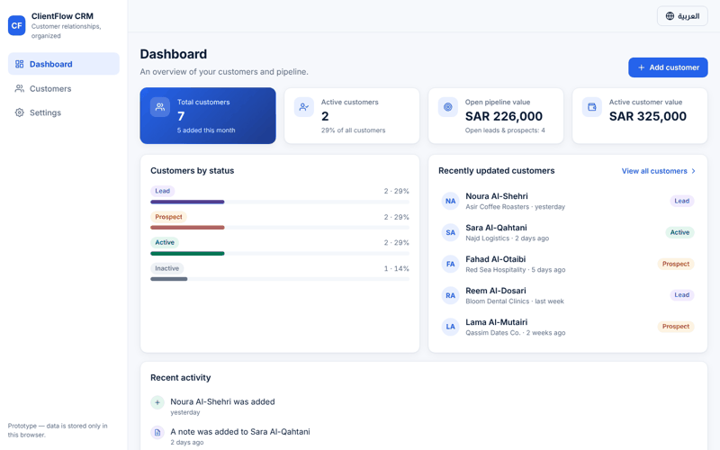

## Screenshots

| English (LTR) | Arabic (RTL) |
| --- | --- |
| 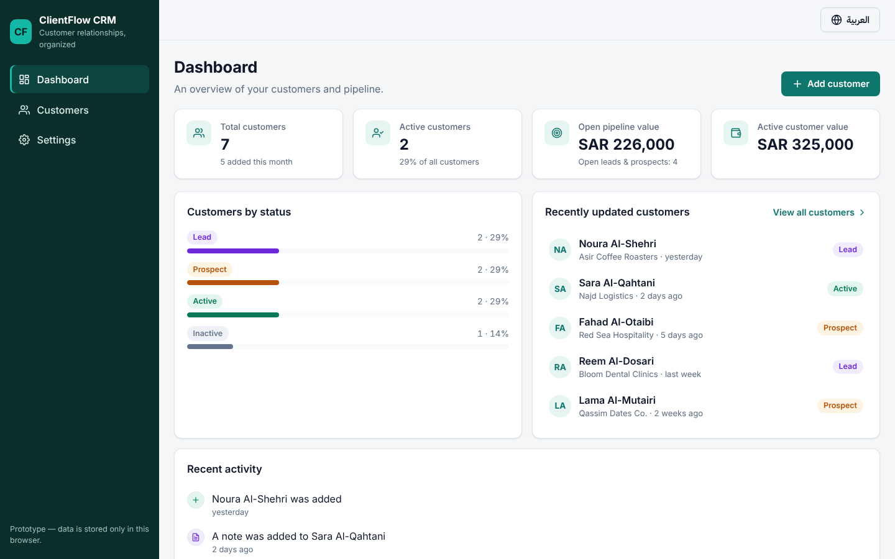 | 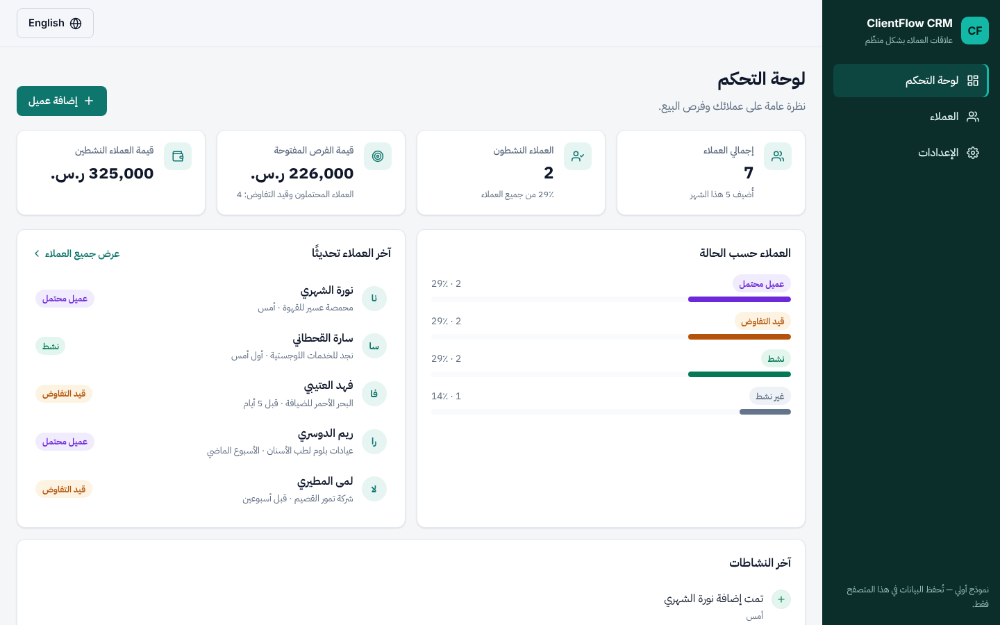 |
| 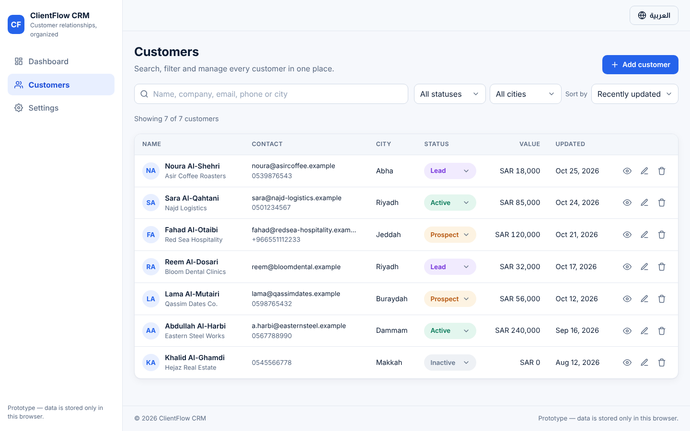 | 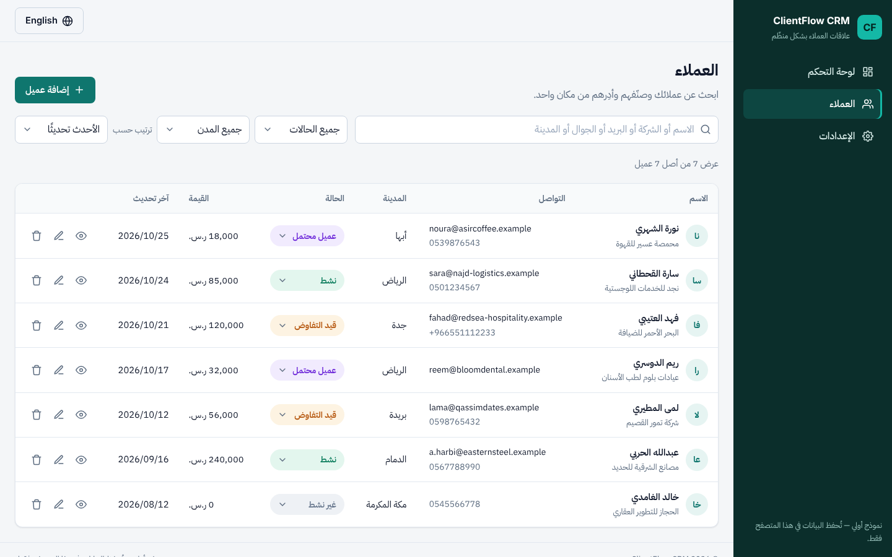 |

**Customer profile (Arabic):** contact details, status, notes and activity

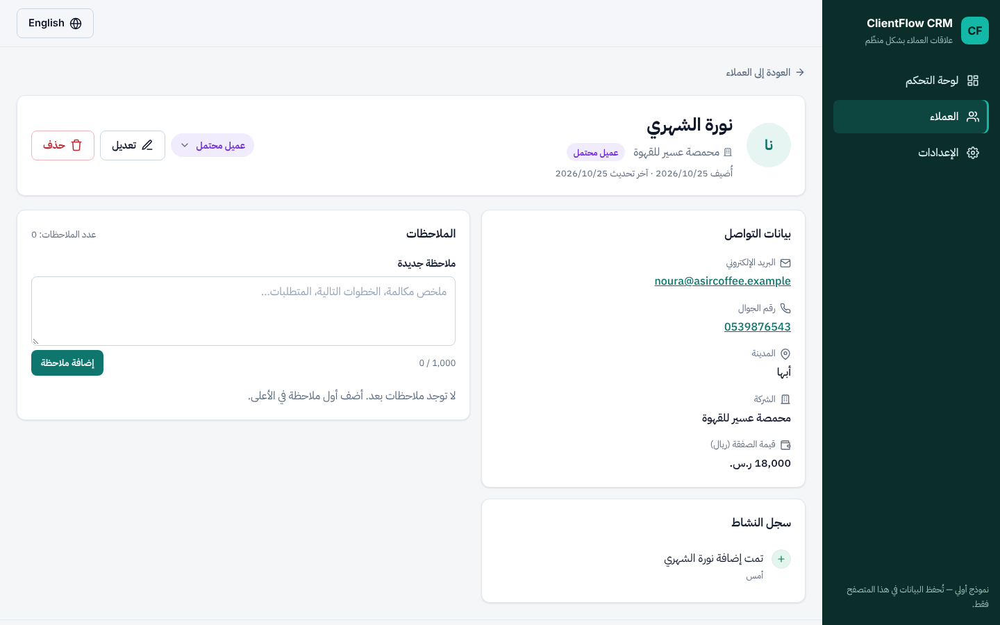

**Mobile**

| Arabic | Menu (Arabic) | English | Search (Arabic) |
| --- | --- | --- | --- |
| 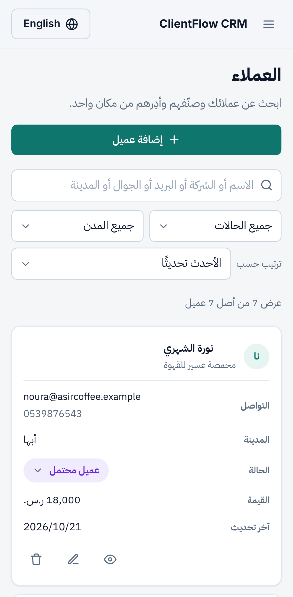 | 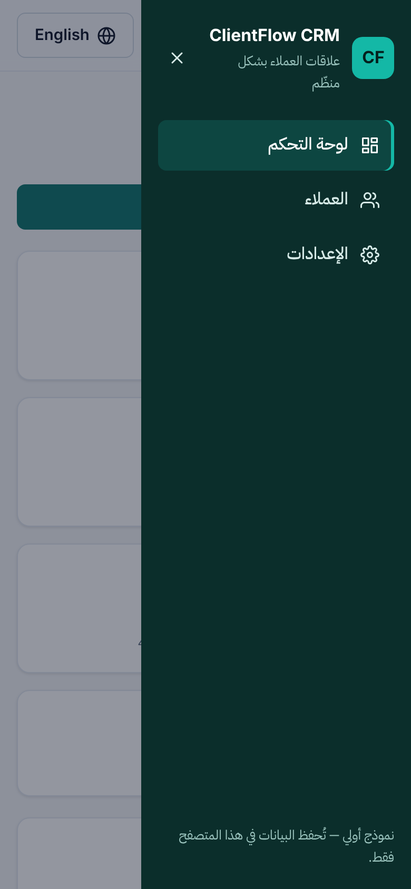 | 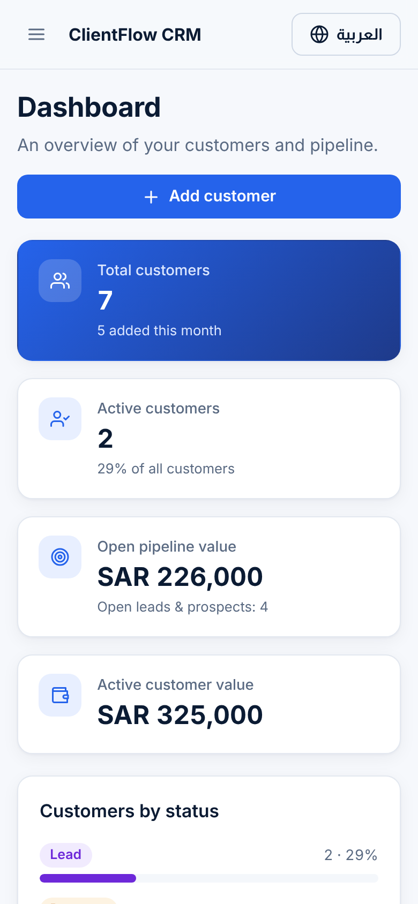 | 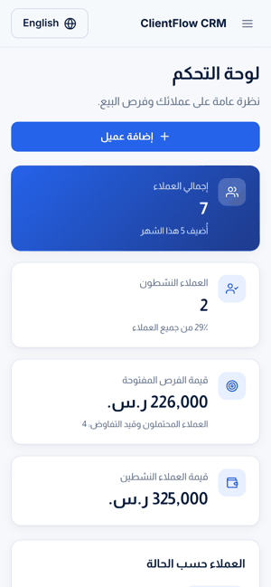 |

**Adding a customer and a note (Arabic)**

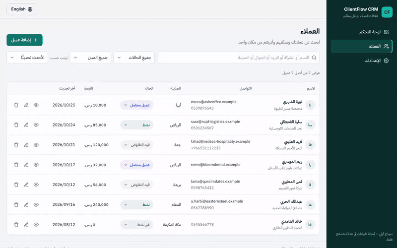

## What's inside

| Area | What it does |
| --- | --- |
| Dashboard | Total and active customers, open pipeline value, new this month, status breakdown, recent customers and activity |
| Customers | Create, view, edit and delete, with confirmation dialogs |
| Search & filters | Search by name, company, email, phone or city; filter by status and city; sort. Arabic search ignores diacritics and أ/إ/آ, ة/ه, ى/ي differences |
| Status | Lead → Prospect → Active → Inactive, changed inline; every change is logged |
| Notes & activity | Notes per customer, and an activity log rendered in the active language |
| Data tools | Export / import a JSON backup, load sample data, clear everything |

**Bilingual details:** typed `en` / `ar` dictionaries (a missing Arabic key fails the build), `<html lang dir>` switches with the language, the choice is saved, and switching never loses typed form values or half-written notes. Layout uses CSS logical properties, so the sidebar and drawer move to the right in Arabic. Amounts are formatted in SAR for each locale.

## Run it

Requires Node.js 20.19+ or 22.12+.

```bash
npm install
npm run dev        # http://localhost:5173
```

| Command | What it does |
| --- | --- |
| `npm run build` | Type-check and build to `dist/` |
| `npm run lint` | ESLint |
| `npm test` | Unit tests (Vitest) |
| `npm run test:e2e` | Playwright tests on desktop and mobile (run `npx playwright install chromium` once) |

## Project structure

```
src/
  i18n/       en.ts, ar.ts, language context
  store/      CRM state, reducer, toasts
  lib/        validation, search/filter/stats, storage, sample data
  hooks/      hash router (#/customers, #/settings, ...)
  components/ AppShell, LanguageSwitcher, Toasts, UI
  pages/      Dashboard, Customers, CustomerDetail, CustomerForm, Settings
tests/        unit (Vitest) and e2e (Playwright)
```

## Deploy

Static build with hash routing and relative paths, so it runs on any static host without rewrite rules.

- **Vercel / Netlify / Cloudflare Pages:** import the repository; build command `npm run build`, output `dist`.
- **GitHub Pages (optional):** in the repository open **Settings → Pages → Source → GitHub Actions**, then run **Actions → Deploy to GitHub Pages → Run workflow**.
- **CI:** `.github/workflows/ci.yml` lints, tests and builds every push.

**Taking it to production** would mean adding an API and database, authentication and server-side validation. `CrmContext` is where a data layer plugs in.

## License

MIT.
